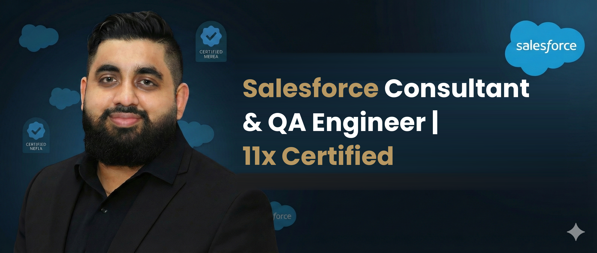

# Mohamed Imran
**Salesforce Consultant & QA Engineer | Federal Public Sector | 11x Salesforce Certified**

Salesforce Consultant & QA Engineer at **Guidehouse**, delivering Salesforce Public Sector Solutions for U.S. Federal clients in a regulated, compliance-first environment. My career started in QA automation (Selenium, Java), then moved into Salesforce administration and consulting at SSP America, American Express, KinderCare, and OneTrust.

**Salesforce is my core. QA is my edge.**

---

## 📈 Impact
| Result | Where | How |
| :--- | :--- | :--- |
| **40% more test coverage, 50% faster execution** | QA Automation | Selenium / Java Page Object Model framework |
| **200+ hours saved per year, 30% less manual effort** | American Express | Flow automation |
| **1,500+ users at 99.9% uptime** | OneTrust | CPQ and GTM systems |
| **30% fewer post-release defects** | Guidehouse | Copado Robotic Testing |

---

## 🧪 QA Projects
Client names withheld.

| Project | Focus |
| :--- | :--- |
| **Federal Salesforce QA Program: Built From Scratch** | Test plan, scenarios, test cases, Jira and Excel tracking, full execution |
| **Permissions & Role-Based Access Validation** | Permissions, role metrics, function sets |
| **Environment & Dependency Risk Analysis** | QA sandbox, shared-org SIT conflict, MuleSoft IL2 vs IL5 |
| **Salesforce QA Framework: Phase-Gated Methodology** | Phases 0 to 7, traceability, entry/exit criteria, bug-validation rule |
| **Test Automation Framework** | Selenium, Java, TestNG, Cucumber, Maven, Jenkins, Postman, RestAssured |
| **Salesforce QA Workbench** | Local tool that generates QA artifacts with the Anthropic API |

---

## ⚡ Salesforce Projects
Personal portfolio projects. Each page links its video demo and screenshots.

| Project | Stack |
| :--- | :--- |
| **[1. Enterprise Flow Series (5-Part Suite)](./project-1-flow-series.md)** Smart Discount Guardrails (CPQ) • Smart Case Escalation • Customer Health Signal Hub • Fair Workload Engine • Real-Time Credit Risk Engine | Advanced Flow, Custom Metadata, Platform Events, External Services, Tableau |
| **[2. Agentforce AI Trust & Compliance: Audit System](./project-2-ai-trust.md)** | Agentforce, Autolaunched Flow, Record-Triggered Flow |
| **[3. Service Cloud: Automated Support Engine](./project-3-service-cloud.md)** | Omni-Channel, Escalation Rules, Dashboards |
| **[4. Onboarding Black Hole: Flow Orchestrator & Experience Cloud](./project-4-orchestrator.md)** | Flow Orchestrator, Experience Cloud, Screen Flows |
| **[5. ApexFlow ERP: End-to-End Supply Chain Automation](./project-5-erp.md)** | Advanced Flow, Custom Schema |
| **[6. Event-Driven Revenue Provisioning](./project-6-revenue.md)** | Platform Events, Flow Orchestrator, Async Flow |
| **[7. Autonomous Aid: The Agentforce-Powered Nonprofit Cloud](./project-7-autonomous-aid-nonprofit-ai/README.md)** | Flow Orchestrator, Prompt Builder, Platform Events, Apex |

---

## 🛠️ Core Competencies
* **QA & Testing:** Test Planning, Functional, Regression, Integration, Smoke, UAT, Defect Triage, Requirement Traceability, SOQL Data Validation, Flow Debugging
* **Test Automation & Tooling:** Copado Robotic Testing, Selenium WebDriver, Java, TestNG, Cucumber, Maven, Page Object Model, Jira / Xray, Jenkins, Postman, RestAssured
* **Flow & AI Automation:** Record-Triggered, Scheduled and Screen Flows, Flow Orchestration, Platform Events, Agentforce, Prompt Builder
* **Clouds & Revenue Operations:** Sales Cloud, Service Cloud, Experience Cloud, Public Sector Solutions, Salesforce CPQ
* **Integration & Data:** REST / SOAP callouts, External Services, Named Credentials, SOQL / SOSL, Data Loader, Bulk API
* **Security & Delivery:** Profiles, Permission Sets, Sharing Rules, Gearset, Copado, Jenkins, Salesforce DX, Jira, Confluence

---

## 🏆 Certifications & Credentials
* Salesforce Certified Platform Administrator
* Salesforce Certified Platform Administrator II
* Salesforce Certified Platform App Builder
* Salesforce Certified Platform Developer
* Salesforce Certified Marketing Cloud Engagement Administrator
* Salesforce Certified Platform Foundations
* Salesforce Certified AI Associate
* Salesforce Certified Sales Cloud Consultant
* Salesforce Certified Service Cloud Consultant
* Salesforce Certified Agentforce Specialist
* Salesforce Certified Data 360 Consultant
* Trailhead All-Star Ranger: 705 badges, 30 superbadges
* Agentforce Ranger

---

## 🎓 Education
* **Master of Business Administration (MBA)**, Human Resources, Strategic Management & Leadership, University of Gloucestershire
* **Bachelor of Science (BS)**, Computer Science and Networking, IIC University of Technology

---

## 📬 Contact
* **LinkedIn:** [linkedin.com/in/mohamedmunas](https://www.linkedin.com/in/mohamedmunas/)
* **Trailhead:** [Trailblazer profile](https://www.salesforce.com/trailblazer/mohamedmunas)
* **Email:** [mohamedimran.munas@gmail.com](mailto:mohamedimran.munas@gmail.com)
